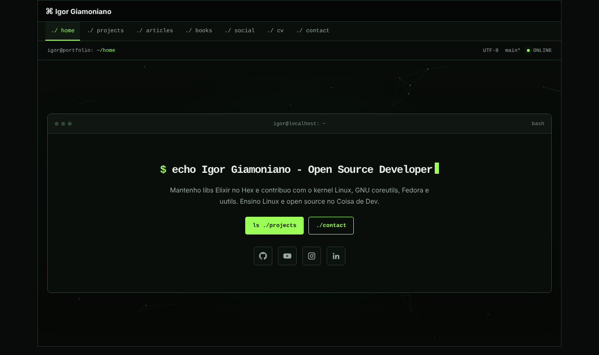

# igorgbr.github.io

Meu portfólio pessoal, no ar em **https://igorgbr.github.io**.

Um único `index.html` com estética de terminal: HTML, CSS e JavaScript puros, sem framework, sem build e sem dependências. As abas funcionam por `#hash`, então o botão voltar do navegador funciona e cada aba tem link próprio (`/#projects`, `/#cv`…).



## Rodar localmente

```bash
git clone https://github.com/igorgbr/igorgbr.github.io.git
cd igorgbr.github.io
python3 -m http.server 8000
# abra http://localhost:8000
```

Ou simplesmente abra o `index.html` no navegador.

## Usar como template

Fique à vontade para fazer fork e adaptar. O que trocar:

- textos, cases e links de cada `<section>` no `index.html`
- `<title>` e as tags `og:*` no `<head>`
- o e-mail do formulário de contato (função no fim do arquivo)

## Licença

O **código** (HTML, CSS e JS) está sob a [licença MIT](LICENSE).

O **conteúdo pessoal** (textos, descrição dos projetos e a foto) não está coberto pela licença. Use como referência, mas escreva o seu.
